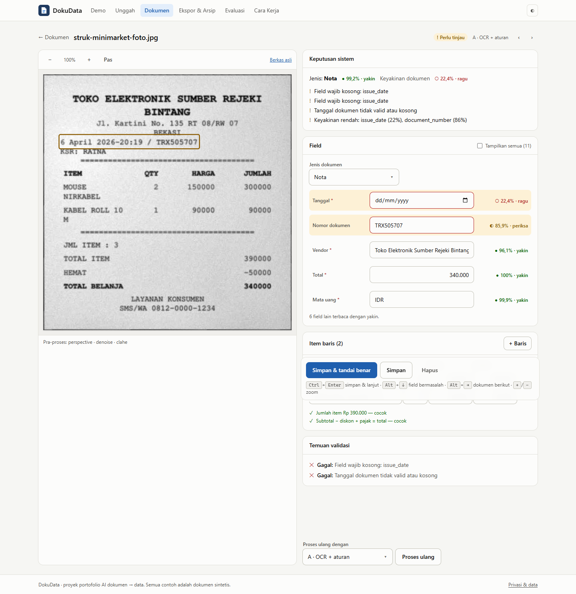

# DokuData

**Photos of Indonesian receipts and invoices in, validated Excel out.** DokuData reads a document (OCR), recognises its type, extracts vendor, date, NPWP, tax, total and line items, checks the arithmetic, scores how sure it is about every field, and asks a human to look only at what is doubtful. Approved data exports to Excel/CSV/JSON and the files are renamed into an archive such as `Arsip/2026/03/Nota/2026-03-14_TokoMajuJaya_NT-0231_1250000.pdf`.

It is a portfolio project, built to show an end-to-end AI system that is **measured**, not just demoed: three extraction methods behind one interface, trained and calibrated models, a frozen test set, and an evaluation report that is regenerated with one command.

<!-- RESULTS:START -->
## Results

Measured on the frozen synthetic test set (448 receipt/invoice images = 224 documents × clean and degraded, plus 152 "other" pages), method A (OCR + rules), laptop CPU. Full tables, confidence intervals and error analysis: **[docs/evaluation-report.md](docs/evaluation-report.md)**.

| PRD success criterion | Target | Measured | |
|---|---|--:|---|
| Document type, macro-F1 | ≥ 0.90 | **1.000** | met |
| F1 vendor, date, total | ≥ 0.90 | **0.962** | met |
| F1 tax and document number | ≥ 0.85 | **0.977** | met |
| F1 line items | ≥ 0.75 | **0.966** | met |
| Auto-approved at ≥ 98 % accuracy | ≥ 50 % | **29.7 %** at 97.0 % | not met |
| One page end-to-end, p95 | ≤ 15 s | **3.5 s** | met |
| Extraction methods compared | ≥ 3 | **1** measured (B, C implemented) | not met yet |

| Condition | F1 vendor | F1 total | F1 items | Doc fully correct | Auto-approved (accuracy) |
|---|--:|--:|--:|--:|--:|
| Known layouts, clean | 0.993 | 0.993 | 0.989 | 93.8 % | 51.4 % (100 %) |
| Known layouts, degraded | 0.983 | 0.979 | 0.945 | 81.9 % | 41.0 % (93.2 %) |
| New layouts + vendors, clean | 0.863 | 1.000 | 0.994 | 82.5 % | 0 % |
| New layouts + vendors, degraded | 0.713 | 0.913 | 0.935 | 60.0 % | 0 % |

What the numbers say:

- **Rules generalise poorly to unseen layouts** (vendor F1 drops from 0.99 to 0.71). The confidence gate catches it: no document from a new layout is auto-approved. That is safe, but it means no automation there, which is exactly where an LLM method should help.
- **Degraded photos of known layouts are where wrong documents slip through** (93.2 % accuracy among auto-approved). The validation split did not predict this, so the threshold chosen on it was optimistic for the test set. The miss is reported as measured, not re-tuned on test.
- **Calibration works:** expected calibration error falls from 0.358 (raw extractor confidence) to 0.0076 (logistic regression + isotonic).
- **Pre-processing halves OCR error on degraded images** (CER 0.209 → 0.111 on known layouts).
- **Prompt injection:** the scanner finds 72 % of injected documents (small injected text is often unreadable to OCR); 92 % go to human review; 5 of 60 were auto-approved. The rules extractor ignores the instructions, so their totals are unaffected by them, but the gap is real for LLM methods that read the image.
- **Methods B and C (Claude)** are implemented, unit-tested with a fake client and wired into the app, but not yet evaluated: that needs API credentials and about $29 of calls (`make llm-eval` prints the estimate).


<!-- RESULTS:END -->

## How it works

```
Upload → Pre-process → OCR → Classify → Extract → Validate → Confidence → Review → Export + Archive
```

| Stage | What happens | Code |
|---|---|---|
| Upload | File type checked from magic bytes, ≤ 10 MB, PDF ≤ 10 pages; job queued | `apps/api/routers/documents.py` |
| Pre-process | EXIF orientation, perspective correction for photos, deskew, denoise, CLAHE. Digital PDFs use their text layer instead of OCR | `pipeline/preprocess/` |
| OCR | PaddleOCR (PP-OCR) models on ONNX Runtime via RapidOCR, word boxes + confidence; Tesseract behind the same interface | `pipeline/ocr/` |
| Classify | `receipt` / `invoice` / `other` with TF-IDF + logistic regression (embedding model compared); `other` lets the system refuse out-of-scope pages | `pipeline/classify/` |
| Extract | **A** OCR + rules, **B** OCR lines → Claude with a strict JSON schema, **C** page image → Claude vision | `pipeline/extract/` |
| Validate | Σ items = subtotal, subtotal − discount + tax = total, qty × price, dates, NPWP format, VAT rate from config, duplicates, amount anomalies | `pipeline/validate/`, `pipeline/duplicates.py` |
| Confidence | Logistic regression on per-field signals (extractor prior, OCR grounding, rule outcomes, cross-method agreement, classifier confidence), isotonic-calibrated | `pipeline/confidence/` |
| Decide | Auto-approve only when the type is certain, required fields exist, every rule passes, every field clears a threshold chosen on validation data, and nothing is flagged | `pipeline/confidence/decision.py` |
| Review | Side-by-side image with highlight boxes and a form; doubtful fields first; keyboard shortcuts | `apps/web/src/pages/ReviewPage.tsx` |
| Export | Excel (summary + items sheets), CSV, JSON, ZIP archive with patterned names | `pipeline/export.py`, `pipeline/archive.py` |

Every engine implements the same small protocol (`pipeline/interfaces.py`), so comparing methods is a configuration change. See the [architecture decision records](docs/adr/).

```
┌──────────────────┐  HTTPS  ┌───────────────────────┐ enqueue ┌──────────────────────────────┐
│ React + Tailwind │ ──────► │ FastAPI (REST + SSE)  │ ──────► │ Redis → RQ workers           │
│ Ark UI           │         │ sessions · signed URLs│         │ preprocess · OCR · classify  │
└──────────────────┘         └──────────┬────────────┘         │ extract · validate · confid. │
                                        │                      └──────┬───────────────┬───────┘
                                   PostgreSQL                    MinIO (S3)     Claude API (optional)
```

## Data and evaluation

There is no real document in this repository. A generator (`ml/synthetic/`) renders HTML/CSS templates with PyMuPDF into PDFs and images with labels attached: 8 receipt, 6 invoice and 7 "other" layouts (letters, CVs, price lists, delivery notes), Indonesian vendors, items, NPWP, PPN 11%/12%, eight date formats and seven number formats. Each document also gets a degraded copy: a phone photo (perspective, rotation, uneven light), a scan, or a faded thermal print, plus blur, noise and JPEG artefacts.

- **Splits:** train 1,200 · val 240 · test_seen 200 · test_unseen 100 · injection 30. `test_unseen` uses layouts and vendor names that never appear in train or validation.
- **Frozen test set:** split digests are stored in [`ml/data/frozen.json`](ml/data/frozen.json) before any model was trained; `run_eval` re-hashes every test file and refuses to run if anything changed.
- **No tuning on test:** rules were tuned on train documents, thresholds and calibration were chosen on validation.
- **Experiments E1–E6** from the PRD: OCR engines, pre-processing on/off, classifiers, extraction methods, calibration, robustness. Full results and error analysis: [docs/evaluation-report.md](docs/evaluation-report.md) and the in-app Evaluation page.

> The numbers describe synthetic documents. Real receipts are messier (creases, handwriting, stamps, free layouts); results on real data have not been measured yet and are expected to be lower.

## Safety and privacy

- Document text is data, never instructions: the LLM has no tools, output is a strict JSON schema validated with Pydantic, every value must be grounded in the OCR text (hallucination check), and documents that try to instruct the model are always sent to a human. Approval is decided by code, not by the model.
- Anonymous per-browser sessions (only a hash of the token is stored), random IDs, HMAC-signed short-lived URLs for images and downloads, rate limits and quotas, uploads deleted after 24 hours and never used for training.
- Spreadsheet formula injection is neutralised in exports. PDFs are rendered to images, never executed.

## Run it

**Docker (everything):**

```bash
cp .env.example .env            # optionally add ANTHROPIC_API_KEY for methods B and C
docker compose up --build       # http://localhost:8080
```

**Local development (Python 3.12+, Node 24):**

```bash
python -m venv .venv
.venv/bin/pip install -e ".[api,ml,dev]"            # Windows: .venv\Scripts\pip
(cd apps/web && npm install)
cp .env.example .env
```

Then, in two terminals (no need to activate the virtualenv):

```bash
# API on :8000 with an in-process worker, SQLite and local storage
.venv/bin/python -m uvicorn api.main:app --app-dir apps --port 8000    # Windows: .venv\Scripts\python
# Web UI on :5173 (proxies /api to the API)
cd apps/web && npm run dev
```

Open http://localhost:5173. Demo documents ship in `apps/api/samples` (rebuild them with `python -m ml.synthetic.make_samples`). On Linux/macOS the same steps are `make install`, `make api` and `make web`.

**Enable methods B and C (Claude):** put `ANTHROPIC_API_KEY=...` in `.env` at the project root (or run `ant auth login`), optionally `DOKUDATA_LLM_MODEL` / `DOKUDATA_LLM_EFFORT`, and restart the API. B and C then become selectable on the Upload, Demo and Review pages; until then they are shown as "belum aktif" and the API refuses them with a clear message. Each document costs money and its content is sent to the Claude API.

The commands above call `.venv\Scripts\python` explicitly, so the virtualenv never needs to be activated in your shell (the workspace's `.vscode/settings.json` turns off automatic activation so other projects are not affected).

**Reproduce the models and the report:**

```bash
make data        # generate the dataset from its seed and verify the frozen test digests
make ocr         # OCR cache for every split (resumable, ~1.5 h on a laptop CPU)
make train       # classifiers, confidence model, thresholds (validation split only)
make evaluate    # reports/latest/summary.json + docs/evaluation-report.md
make llm-eval    # methods B and C: prints a cost estimate; YES=1 to call the API
```

**Tests:** `make test` (unit, API integration, and an ML regression gate that fails CI if extraction drops below fixed floors), `make lint` (Ruff, mypy, ESLint, TypeScript).

## Tech stack

Python · FastAPI · Pydantic · SQLAlchemy · PostgreSQL · Redis + RQ · MinIO/S3 · OpenCV · PyMuPDF · RapidOCR (PP-OCR on ONNX Runtime) · Tesseract · scikit-learn · sentence-transformers · Anthropic SDK (Claude, structured outputs) · React 19 · TypeScript · Tailwind CSS 4 · Ark UI · Vite · Docker Compose · GitHub Actions.

## Project layout

```
apps/api/        FastAPI app, worker, storage, security
apps/web/        React UI (upload, documents, review, export, evaluation, how it works)
pipeline/        the core library, usable without the API
ml/synthetic/    document generator
ml/training/     classifier and confidence training
ml/evaluation/   metrics, OCR/LLM caches, run_eval, report
config/          validation rules (VAT rates are configuration, not code)
models/          trained models (small, versioned with the code)
docs/            evaluation report, model card, ADRs
tests/           unit, integration, ML regression
```

## Deviations from the PRD

- **Python 3.14 locally, 3.12 in Docker.** The code targets 3.12+.
- **OCR:** PaddleOCR runs through RapidOCR/ONNX instead of the PaddlePaddle runtime (no wheels for the local Python, much lighter on a CPU server).
- **Database migrations:** tables are created with `create_all` on start-up; Alembic is the next step once the schema has a second version.
- **TypeScript 6** instead of 7 so `typescript-eslint` can lint the frontend.
- **Second document pack (CV / delivery note):** delivery notes and CVs exist only as negative examples of the `other` class; a dedicated extraction schema for them is future work (PRD 18.1 drops it first when time is short).

## License

MIT
